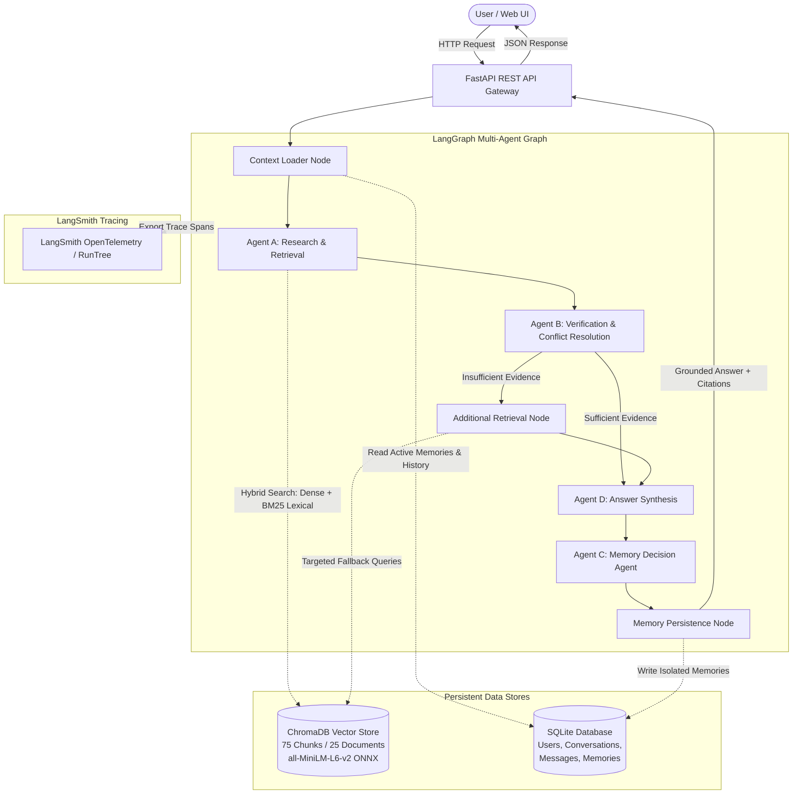

# Asterline AI Research Assistant — Architecture & System Design

## 1. System Overview

The **Asterline AI Research Assistant** is an enterprise-grade multi-agent research and knowledge-retrieval system built for Asterline Labs. It combines a local hybrid vector retrieval pipeline, a 4-agent LangGraph orchestration graph, persistent per-user memory isolation with SQLite, and end-to-end observability via LangSmith.

---

## 2. Multi-Agent System Roles & Graph Topology

The system strictly decouples the responsibilities of research, fact checking, synthesis, and memory management into four distinct agent specializations orchestrated as a directed state graph:

### Agent A: Research & Retrieval Agent (`ResearchAgent`)
* **Role:** Formulates lexical and semantic queries, expands domain-specific vocabulary (e.g. mapping "stipend" to weekly on-call compensation, "cold recovery" to RTO tiers), and queries the local ChromaDB vector store.
* **Retrieval Mechanism:** Implements Reciprocal Rank Fusion (RRF) between dense ONNX cosine similarity embeddings and tokenized lexical overlap search, dynamically expanding `top_k` for multi-hop or comparative prompts.
* **Non-Duplication:** Evaluates retrieval quality against an empirical score threshold ($\ge 0.15$), identifying when reformulation is necessary.

### Agent B: Evidence Verification & Conflict Resolution Agent (`VerificationAgent`)
* **Role:** Analyzes retrieved chunks for semantic relevance, factual consensus, and temporal supersession.
* **Conflict Resolution Hierarchy:** Does *not* simply select the latest publication date. Instead, it evaluates:
  1. **Topic Specificity:** Exact clause matching over generalized guidelines.
  2. **Explicit Supersession Language:** Regex parsing for declarative supersession statements (`supersedes earlier handbook policies`, `replaces v1.0`).
  3. **Effective Date vs Publication Date:** Distinguishing between operational effective dates and archival publish timestamps.
  4. **Scope & Version Applicability:** Patch notes vs minor version increments.
* **Uncertainty Calibration:** Emits an explicit uncertainty level (`low`, `medium`, `high`) and records conflict explanations if assertions cannot be fully reconciled.

### Agent C: Memory Management Agent (`MemoryAgent`)
* **Role:** Analyzes ongoing dialogue to detect long-term user preferences, background context, project milestones, and explicit corrections or forget requests.
* **Safety & Non-Authoritativeness:** Evaluates candidate statements against strict safety filters. Passwords, bearer tokens, API keys, and sensitive credentials are unconditionally rejected. Furthermore, AI-generated documentary answers are barred from being saved as user memories.
* **Zero DB Coupling:** Emits pure declarative `MemoryOperation` objects (`CREATE`, `UPDATE`, `DELETE`, `FORGET_ALL`). Database writes are reserved strictly for the validated persistence node.

### Agent D: Synthesis Agent (`SynthesisAgent`)
* **Role:** Compiles verified evidence into clear, objective markdown answers formatted with exact inline documentary citations (`chunk_id`, document title, version).
* **Limitations Warning:** Explicitly calls out missing evidence, unresolved contradictions, or lack of coverage in Asterline's documentation (e.g. unannounced APAC regional availability).

---

## 3. Persistent Memory Architecture & Strict User Isolation

User memory is persisted in SQLite (`data/asterline.db`) across five distinct categories:
* `preferences`: Formatting and style choices (e.g. "Prefers concise bulleted lists").
* `user_context`: Role and technical specialization (e.g. "Platform engineer working on distributed query engine").
* `active_projects`: Ongoing operational focus.
* `decisions`: Architectural or project-specific determinations made during sessions.
* `conversation_summaries`: High-level session digests.

### Isolation Guarantees
* **Mandatory Ownership Checks:** Every query and database operation (`select`, `insert`, `update`, `delete`) filters on `user_id == current_user_id`.
* **Cross-User Leakage Defense:** If User B attempts to access, query, or delete a memory belonging to User A, the operation returns empty results or rejection (`not owned by user`).
* **Memory Provenance:** When a user corrects a prior memory (e.g. "Actually my timezone changed to EST"), the previous memory is transitioned to status `corrected`, and the new record stores a backward provenance pointer (`correction_of:<prior_uuid>`).

---

## 4. Observability & LangSmith Integration

When configured with `LANGCHAIN_TRACING_V2=true` and `LANGSMITH_API_KEY`:
* The graph automatically streams execution spans, node latency, input/output states, and prompt payloads to the configured LangSmith project (`asterline-research-assistant`).
* Granular step timings (`load_context`, `research`, `verification`, `synthesis`, `memory_decision`, `memory_persist`) are attached to API response payloads under `agent_trace` for real-time frontend inspection.
* Project sharing is designated for team evaluation (`radialpulse@nxtwave.co.in`).

